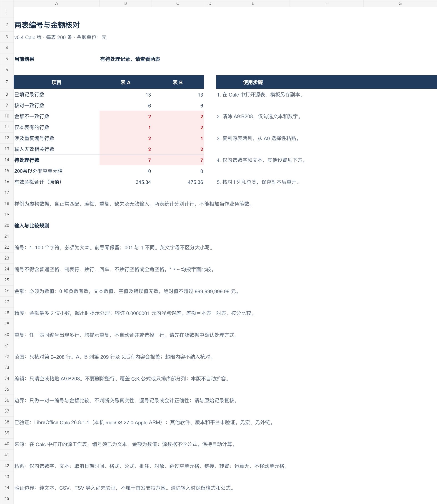
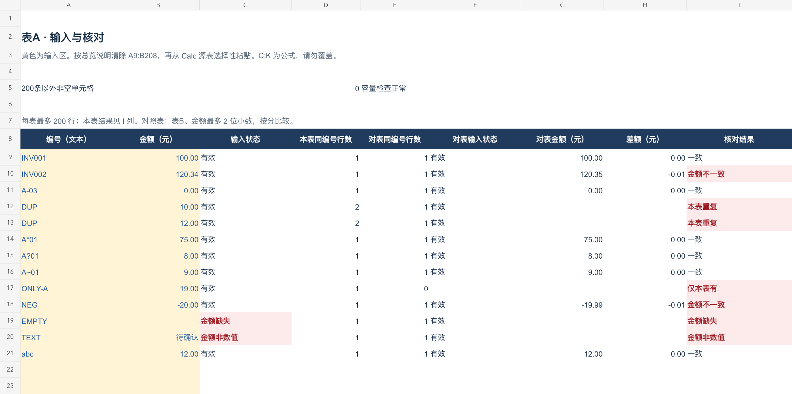
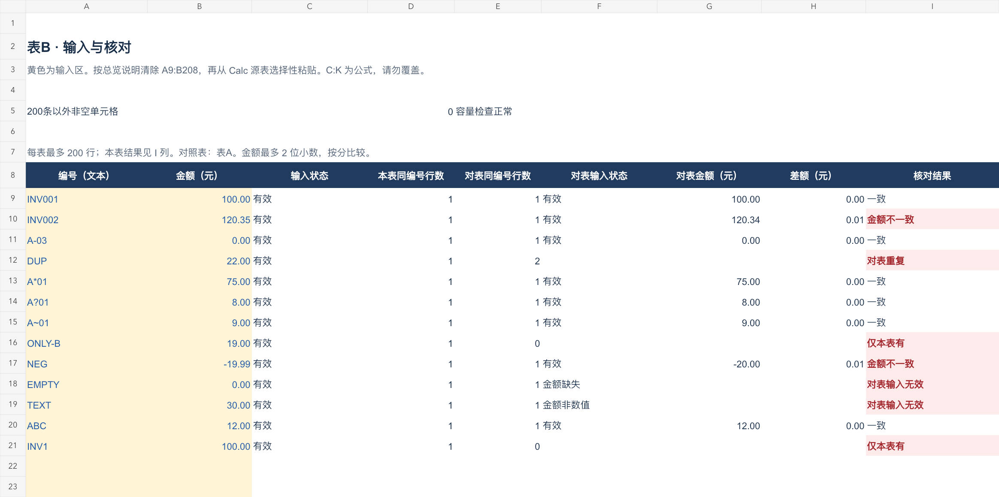

# 简表工具坊

## 两表编号与金额核对模板

这是简表工具坊制作的原创表格作品，当前版本为 **v0.4 Calc 版**。作品用于辅助检查两份编号与金额清单，分别提示金额差异、单边缺失、重复编号和无效输入，方便使用者回到原始记录逐项复核。

工作簿包含“核对总览”“表A”“表B”三个工作表。每表支持 200 行数据，填写编号和金额后，可在 I 列查看逐行结果，在总览查看汇总。

演示使用虚构数据，包含正常匹配、金额差异、重复编号、单边缺失、零金额和负金额等情况。

## 作品预览

### 核对总览

### 表 A

### 表 B

## 使用边界

本作品只比较输入的编号和金额，不判断交易真实性、漏导记录或会计正确性。重复编号需由使用者根据原始记录处理，不自动合并。

## 当前进度

已在本机 **LibreOffice Calc 26.8.1.1、macOS 27.0（Apple ARM）** 实测通过列明的计算与录入场景：样例金额修改联动、异常与容量边界，以及从 Calc 源工作表复制 16 行异常组合和每表 200 行数据，按指定设置选择性粘贴、强制重算、保存为 XLSX、关闭重开。文本编号、前导零、数值、真正空白和原有公式保持符合预期。

首发录入流程限于 **Calc 工作表已有单元格之间的复制与选择性粘贴**，源区域只包含字面文本、数值和真正空白，不含源公式。选择性粘贴只勾选数字和文本，关闭跳过空单元格，运算为无，不移动单元格，其余选项关闭。

结论限于上述环境和已测操作。**纯文本、CSV/TSV 导入及从网页直接粘贴不在首发支持范围；Excel、WPS、其他版本和系统未验证。**

**当前为作品展示与上线准备阶段。爱发电创作者认证已提交，仍待审核；付款后文件自动交付尚待验证，商品尚未开放购买。**

[简表工具坊的爱发电主页](https://afdian.com/a/jianbiaotools)
